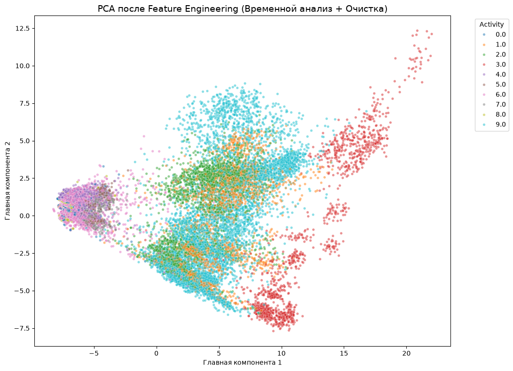

# Human Activity Recognition (HAR) from Wearable Sensors

Classifying **10 everyday activities** (walking, running, stairs, sitting, elevators and more) from leg-worn IMU and EMG sensors, evaluated honestly on **people the model has never seen**.

**Stack:** Python, pandas, NumPy, SciPy (FFT), scikit-learn, XGBoost, CatBoost, Matplotlib, Seaborn

## Results

The best model, a Random Forest, reaches **88.7% accuracy and 0.86 macro-F1** on 6 people held out from training, against a 36% baseline. Leave-one-subject-out validation across all 18 people gives **macro-F1 0.88 ± 0.07**.

| Model | Accuracy | Balanced accuracy | Macro-F1 |
|---|---:|---:|---:|
| Baseline (most frequent class) | 0.364 | – | – |
| **Random Forest** | **0.887** | **0.855** | **0.858** |
| XGBoost | 0.887 | 0.854 | 0.857 |
| HistGradientBoosting | 0.885 | 0.852 | 0.857 |
| CatBoost | 0.879 | 0.842 | 0.846 |
| Decision Tree | 0.836 | 0.781 | 0.791 |

Test set: 6,228 windows from 6 unseen subjects. Train set: 11,885 windows from the other 12.

| Validation | Macro-F1 |
|---|---|
| Leave-one-subject-out, Random Forest (18 folds) | 0.884 ± 0.065 (min 0.792, max 1.000) |
| Group split 70/15/15, 5 seeds | 0.842 ± 0.045 |
| Group split 80/10/10, 5 seeds | 0.829 ± 0.043 |

## Key findings

- **Movement is easy, elevators are hard.** Walking, running, stairs and sitting all score F1 ≥ 0.98. Elevator rides are the weak spot: `down_by_elevator` has recall 0.24 (50% of its windows are predicted as `standing`), `up_by_elevator` has recall 0.43. To leg-worn sensors, riding an elevator looks almost the same as standing still.
- **Thigh accelerometers carry the most signal.** Most of the top-10 features by both MDI and permutation importance come from the thigh accelerometers, led by `accelerometer_right_thigh_z_mean` and `accelerometer_right_thigh_x_max`.
- **Generalizing to new people is the real challenge.** Per-subject LOSO scores range from 0.79 to 1.00, so the same model works much better for some people than for others.



*PCA of the engineered features: running separates clearly, walking and stairs partly overlap, and the static activities (standing, sitting, elevators) collapse into one cluster on the left.*

## Dataset

[HuGaDB, the Human Gait Database](https://www.kaggle.com/datasets/romanchereshnev/hugadb-human-gait-database), from Kaggle:

- 1,137,279 rows from 18 subjects and 28 recording sessions
- 38 sensor channels: 6 IMUs (accelerometer + gyroscope, x/y/z) on the right and left foot, shin and thigh (36 channels), plus 2 EMG channels
- Sampling rate ≈ 56.3 Hz
- 10 activity labels, heavily imbalanced: `walking` makes up 28% of windows, while `sitting_down` makes up 0.17%

## Pipeline

All steps are in [`notebooks/01_eda.ipynb`](notebooks/01_eda.ipynb).

1. **Cleaning.** Detect IMU sentinel values and EMG saturation, interpolate gaps linearly *within* each subject and session (never across them), and downcast to float32.
2. **Windowing.** Use windows of 100 samples (≈1.8 s) with 50% overlap. A window is kept only if at least 80% of its samples share one label. This gives 18,113 windows; 4,082 mixed windows are dropped.
3. **Feature engineering: 328 features.**
   - For each of the 36 IMU axes: mean, std, min, max, median, zero-crossing rate, dominant frequency (FFT with a Hann window), spectral energy
   - For each of the 12 x/y/z sensor triplets: magnitude mean, magnitude std, signal magnitude area
   - For each of the 2 EMG channels: mean absolute value, RMS
4. **Feature selection.** Drop features with |r| > 0.95, computed on the training set only. 229 features remain.
5. **Leakage-free validation.**
   - Train and test are split by **subject**, not by row (`GroupShuffleSplit`), and the code asserts that no subject appears in both.
   - Leave-one-subject-out cross-validation over 18 folds.
   - Sanity check: held-out macro-F1 sits 0.39 std below the LOSO mean. A leaky split would land well *above* it.
6. **Models.** A `DummyClassifier` baseline, Decision Tree, Random Forest, HistGradientBoosting, XGBoost and CatBoost, all trained with balanced class weights.
7. **Diagnostics.** Train vs validation loss curves, confusion matrix, per-class ROC and precision-recall curves, a calibration curve, and MDI plus permutation importance. Everything is exported to [`notebooks/model_report.xlsx`](notebooks/model_report.xlsx).

## Project structure

```
├── notebooks/
│   ├── 01_eda.ipynb          # EDA, cleaning, features, validation, models
│   └── model_report.xlsx     # metrics, confusion matrix, top errors, feature importance, LOSO
├── src/
│   └── main.py               # downloads HuGaDB from Kaggle and merges the CSVs into one parquet
├── hugadb_cleaned.parquet    # merged dataset (1.1M rows × 42 columns)
└── output.png                # PCA of engineered features
```

## How to run

The merged dataset `hugadb_cleaned.parquet` is already in the repository, so you can open the notebook directly:

```bash
pip install pandas numpy scipy scikit-learn xgboost catboost optuna matplotlib seaborn pyarrow joblib openpyxl
jupyter notebook notebooks/01_eda.ipynb
```

To rebuild the parquet from the raw data, put your Kaggle API token in `~/.kaggle/kaggle.json` and run `python src/main.py`.

## Next steps

- Finish hyperparameter search with Optuna. The search is set up with subject-grouped cross-validation, but the run in the notebook has not completed yet.
- Improve the elevator classes with longer windows, sequence models (1D-CNN, LSTM) or features built for vertical acceleration.
- Add per-subject normalization to reduce the gap between people.
